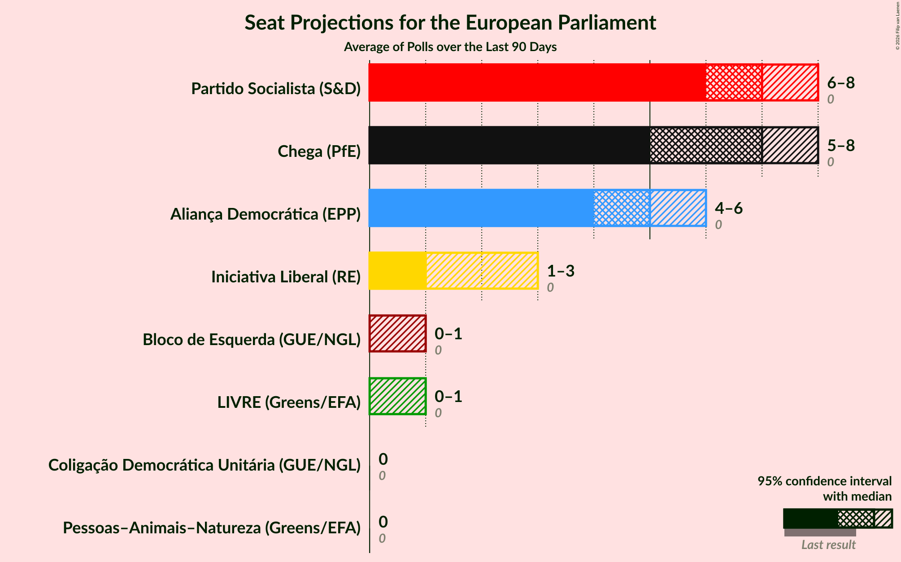
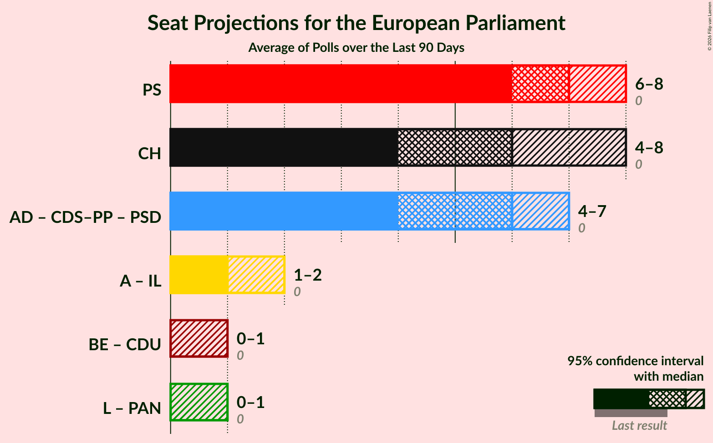

# Overview

The table below lists the most recent polls (less than 90 days old) registered and analyzed so far.

| Period     | Polling firm/Commissioner(s) | CDU | BE | PAN | L | PS | IL | A | PSD | CDS–PP | AD | CH |
|:----------:|:----------------------------:|:--:|:--:|:--:|:--:|:--:|:--:|:--:|:--:|:--:|:--:|:--:|
| 9 June 2024 | General Election | 0.0%   0 | 0.0%   0 | 0.0%   0 | 0.0%   0 | 0.0%   0 | 0.0%   0 | 0.0%   0 | 0.0%   0 | 0.0%   0 | 0.0%   0 | 0.0%   0 |
| N/A | [Poll Average](average.html) | 1–4%   0 | 1–4%   0–1 | 1–4%   0 | 2–6%   0–1 | 25–32%   6–8 | 4–12%   1–3 | N/A   N/A | N/A   N/A | N/A   N/A | 19–26%   4–6 | 21–34%   5–8 |
| [14 September–12 October 2026](2026-10-12-Pitagórica.html) | Pitagórica   CNN Portugal, Sol and TVI | 2–4%   0–1 | 1–3%   0 | 1–2%   0 | 2–5%   0–1 | 25–32%   6–8 | 5–9%   1–2 | N/A   N/A | N/A   N/A | N/A   N/A | 20–26%   5–6 | 25–31%   6–7 |
| [6–7 October 2026](2026-10-07-Aximage.html) | Aximage   Diário de Notícias | 1–3%   0 | 1–3%   0 | 1–4%   0 | 2–5%   0–1 | 25–33%   6–8 | 4–8%   0–2 | N/A   N/A | N/A   N/A | N/A   N/A | 18–26%   4–6 | 27–35%   6–8 |
| [7–14 September 2026](2026-09-14-Intercampus.html) | Intercampus   Correio da Manhã | 1–4%   0–1 | 2–4%   0–1 | 1–4%   0 | 3–6%   0–1 | 24–31%   6–8 | 8–13%   1–3 | N/A   N/A | N/A   N/A | N/A   N/A | 20–27%   5–7 | 20–28%   5–7 |
| 9 June 2024 | General Election | 0.0%   0 | 0.0%   0 | 0.0%   0 | 0.0%   0 | 0.0%   0 | 0.0%   0 | 0.0%   0 | 0.0%   0 | 0.0%   0 | 0.0%   0 | 0.0%   0 |

Only polls for which at least the sample size has been published are included in the table above.

**Legend:**
+ **Top half of each row:** Voting intentions (95% confidence interval)
+ **Bottom half of each row:** Seat projections for the European Parliament (95% confidence interval)
+ **CDU:** Coligação Democrática Unitária (GUE/NGL)
+ **BE:** Bloco de Esquerda (GUE/NGL)
+ **PAN:** Pessoas–Animais–Natureza (Greens/EFA)
+ **L:** LIVRE (Greens/EFA)
+ **PS:** Partido Socialista (S&D)
+ **IL:** Iniciativa Liberal (RE)
+ **A:** Aliança (RE)
+ **PSD:** Partido Social Democrata (EPP)
+ **CDS–PP:** CDS–Partido Popular (EPP)
+ **AD:** Aliança Democrática (EPP)
+ **CH:** Chega (PfE)
+ **N/A (single party):** Party not included the published results
+ **N/A (entire row):** Calculation for this opinion poll not started yet

